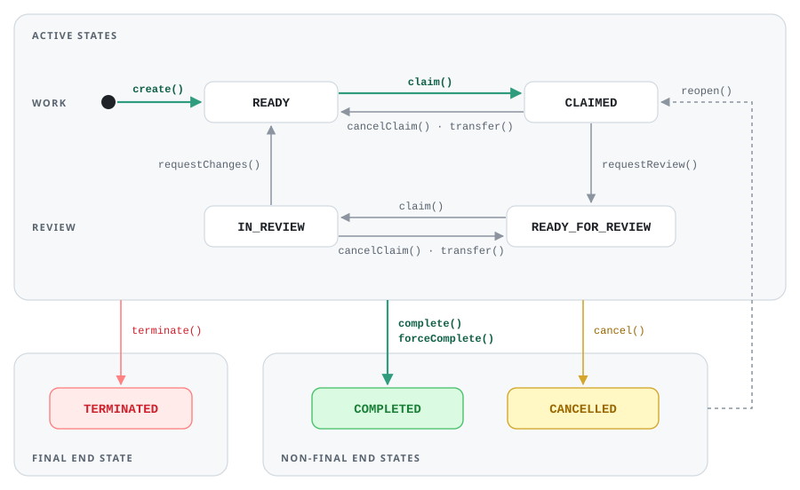
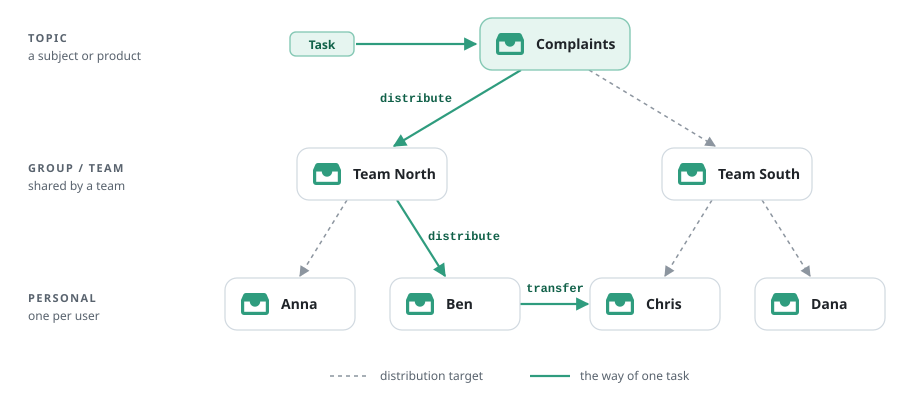
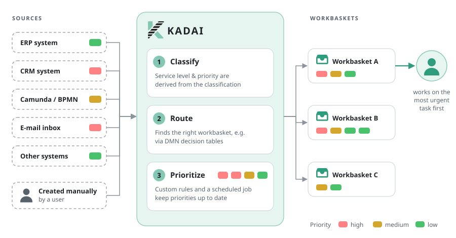
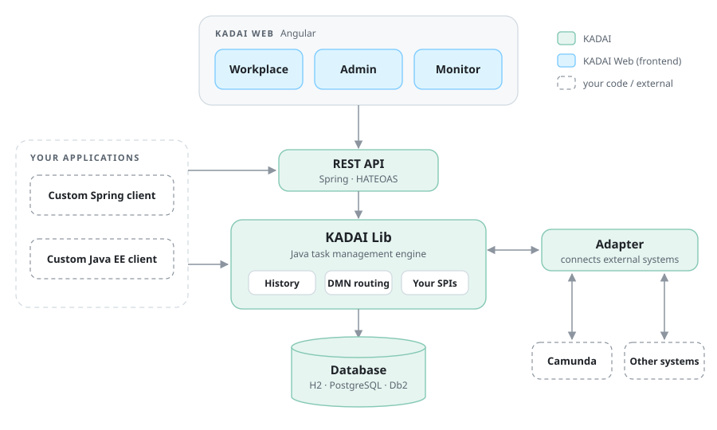

<div align="center">

<picture>
  <source media="(prefers-color-scheme: dark)" srcset="docs/images/hero-dark.svg">
  
</picture>

**Embed it into your Java application – or run it standalone.**<br>
Workbaskets, classifications, routing and dynamic prioritization to control and monitor large amounts of tasks.

<br>

[](https://github.com/kadai-io/kadai/actions/workflows/continuous-integration.yml)
[](https://central.sonatype.com/artifact/io.kadai/kadai-core)
[](https://adoptium.net/)
[](LICENSE)
[](https://sonarcloud.io/summary/new_code?id=kadai-io_kadai)
[](https://sonarcloud.io/summary/new_code?id=kadai-io_kadai)

[**Website**](https://kadai.io/) &nbsp;·&nbsp;
[**Live demo**](#live-demo) &nbsp;·&nbsp;
[**Getting started**](#getting-started) &nbsp;·&nbsp;
[**Discussions**](https://github.com/kadai-io/kadai/discussions) &nbsp;·&nbsp;
[**Issues**](https://github.com/kadai-io/kadai/issues)

</div>

<br>

## What is KADAI?

KADAI is an open source task management library. It can be embedded into your application or be
operated standalone if appropriate. Beyond the basic task management functionality, KADAI adds
**workbaskets** and **classifications** to control and monitor a large amount of tasks within a
larger organization.

<table>
  <tr>
    <td width="33%" valign="top">
      <a href="#tasks"><b>📋&nbsp; Tasks</b></a><br>
      The central entity – with priority, due date, a well-defined lifecycle and a reference to the
      business object it belongs to.
    </td>
    <td width="33%" valign="top">
      <a href="#workbaskets"><b>🗂️&nbsp; Workbaskets</b></a><br>
      Personal, team and topic workbaskets distribute tasks to the people responsible for them.
    </td>
    <td width="33%" valign="top">
      <a href="#classifications"><b>🏷️&nbsp; Classifications</b></a><br>
      Identify the type of a task and derive major attributes such as its service level and
      priority.
    </td>
  </tr>
  <tr>
    <td valign="top">
      <a href="#routing--prioritization"><b>🧭&nbsp; Routing</b></a><br>
      Assign incoming tasks to the correct workbasket – and redistribute them between workbaskets.
    </td>
    <td valign="top">
      <a href="#routing--prioritization"><b>⚡&nbsp; Prioritization</b></a><br>
      Dynamic priorities make sure the most important tasks are always addressed first.
    </td>
    <td valign="top">
      <a href="#architecture"><b>📊&nbsp; Monitoring</b></a><br>
      See how well service levels are met and how much work lies with each of your teams.
    </td>
  </tr>
  <tr>
    <td valign="top">
      <a href="#customize-behavior"><b>🧩&nbsp; Extensible</b></a><br>
      Hook your own logic into KADAI through Java Service Provider Interfaces (SPIs).
    </td>
    <td valign="top">
      <a href="#architecture"><b>🕓&nbsp; History</b></a><br>
      Record task, workbasket and classification events – in the database or in your logs.
    </td>
    <td valign="top">
      <a href="#sustainability"><b>🌱&nbsp; Sustainable</b></a><br>
      Awarded the <i>Blauer Engel</i> eco-label for resource- and energy-efficient software.
    </td>
  </tr>
</table>

> [!TIP]
> **Using KADAI?** We're not aware of all installations of our open source project – but we love
> listening to your feedback, discussing possible use cases with you and aligning the roadmap to
> your needs. Feel free to [get in touch](#contact), also if you need consulting support.

**Contents:**
[Core concepts](#core-concepts) ·
[Architecture](#architecture) ·
[Getting started](#getting-started) ·
[Customize behavior](#customize-behavior) ·
[Live demo](#live-demo) ·
[Releases](#releases) ·
[Sustainability](#sustainability) ·
[Contact](#contact)

<br>

## Core concepts

### Tasks

Tasks are the main entity of KADAI. Each task has describing attributes like priority and due date,
and a state. A task also holds a reference to the system and business object it is associated
with – important, since KADAI is meant to be a standalone component. All tasks are placed in a
workbasket to control and direct their handling.

<picture>
  <source media="(prefers-color-scheme: dark)" srcset="docs/images/task-lifecycle-dark.svg">
  
</picture>

- `complete()` requires a claimed task (`CLAIMED` or `IN_REVIEW`). If a
  [`ReviewRequiredProvider`](lib/kadai-core/src/main/java/io/kadai/spi/task/api/ReviewRequiredProvider.java)
  decides that the task needs a review, KADAI requests one instead.
- `forceComplete()`, `cancel()` and `terminate()` work from every active state.
- `COMPLETED` and `CANCELLED` tasks can be reopened – `TERMINATED` is final.

### Workbaskets

Workbaskets are the main structure to distribute tasks to the available users. There are
**personal**, **group/team** and **topic** workbaskets.

Workbaskets indicate the responsibility for a task. The concept of workbaskets allows to
differentiate between the permissions or skills required to complete specific tasks and the
determination of who should complete them – which can diverge a lot in a larger organization.

<picture>
  <source media="(prefers-color-scheme: dark)" srcset="docs/images/workbaskets-dark.svg">
  
</picture>

Permissions such as `READ`, `OPEN`, `APPEND`, `TRANSFER`, `DISTRIBUTE` and `EDITTASKS` control who
may do what in a workbasket, while *distribution targets* define where its tasks may be passed on to.

### Classifications

Classifications identify the type of a task. The task derives some major attributes from its
classification, such as the service level and the priority. Classifications are configured by a
responsible business administrator to control the handling of the tasks.

### Routing & prioritization

KADAI offers various routing and distribution functions to assign incoming tasks to the correct
workbaskets, or to redistribute them between workbaskets. Dynamic prioritization functions allow
you to control the processing sequence of tasks at any time – so the most important tasks are always
addressed first.

<picture>
  <source media="(prefers-color-scheme: dark)" srcset="docs/images/routing-prioritization-dark.svg">
  
</picture>

Routing, distribution and prioritization are pluggable: implement a
[`TaskRoutingProvider`](lib/kadai-core/src/main/java/io/kadai/spi/routing/api/TaskRoutingProvider.java),
[`TaskDistributionProvider`](lib/kadai-core/src/main/java/io/kadai/spi/task/api/TaskDistributionProvider.java)
or [`PriorityServiceProvider`](lib/kadai-core/src/main/java/io/kadai/spi/priority/api/PriorityServiceProvider.java)
– or use the [DMN-based router](routing/kadai-spi-routing-dmn-router) that ships with KADAI.

<br>

## Architecture

<picture>
  <source media="(prefers-color-scheme: dark)" srcset="docs/images/architecture-dark.svg">
  
</picture>

KADAI splits up into five components:

| Component | Description |
| :-- | :-- |
| **KADAI&nbsp;Lib** | The Java library providing the task management functions. |
| **KADAI&nbsp;REST&nbsp;API** | REST API to allow remote access to the KADAI system. |
| **KADAI&nbsp;Workplace** | Angular-based web application to work on the tasks – a sample task list application you can use if appropriate. |
| **KADAI&nbsp;Admin** | Angular-based web application to configure the system, supporting workbaskets and classifications. |
| **KADAI&nbsp;Monitor** | Angular-based web application to monitor the status of the entire task pool. Provides views and statistics about the conformance with defined service levels and shows the workload of your organization and the individual teams. |

On top, KADAI ships optional plugins:

| Plugin | Description |
| :-- | :-- |
| **Simple&nbsp;history** | Stores task, workbasket and classification events in the KADAI database.<br><sub>[`kadai-simplehistory-provider`](history/kadai-simplehistory-provider) · REST: [`kadai-simplehistory-rest-spring`](history/kadai-simplehistory-rest-spring)</sub> |
| **Log&nbsp;history** | Writes all KADAI events to your log.<br><sub>[`kadai-loghistory-provider`](history/kadai-loghistory-provider)</sub> |
| **DMN&nbsp;routing** | Routes tasks to workbaskets based on DMN decision tables.<br><sub>[`kadai-spi-routing-dmn-router`](routing/kadai-spi-routing-dmn-router) · REST: [`kadai-routing-rest`](routing/kadai-routing-rest)</sub> |

<br>

## Getting started

As KADAI is meant to be integrated into the development environment and processes of your
organization, you create your own small integration project as a wrapper and starting point for
your customizations. We currently provide examples of how to run KADAI as a Spring Boot application.

> [!NOTE]
> Only interested in how KADAI looks and feels? Try our [live demo](#live-demo) instead.

### Requirements

| | Version |
| :-- | :-- |
| ☕ **Java** | 21 or newer |
| 🗄️ **H2** | as managed by Spring Boot |
| 🐘 **PostgreSQL** | tested with 17 |
| 🗄️ **IBM Db2** | tested with 12.1 |

<sub>Other versions of the named databases should work as well, but haven't been tested.</sub>

### Run the Spring Boot example

The [Spring Boot example](rest/kadai-rest-spring-example-boot) starts KADAI with the REST API and the
web application on an in-memory H2 database filled with sample data.

**1.** Build the web application *(optional, requires Node.js with Corepack)*:

```bash
cd web && corepack enable && yarn install && yarn build:prod && cd ..
```

**2.** Build KADAI:

```bash
./mvnw clean install -DskipTests
```

**3.** Start the example application:

```bash
./mvnw spring-boot:run -pl :kadai-rest-spring-example-boot
```

**4.** Open <http://localhost:8080/kadai> and log in with username `teamlead-1` and password
`teamlead-1`.

> [!TIP]
> Add `-P history.plugin` or `-P dmn-routing.plugin` to the last command to try out the
> history or the DMN routing plugin.

### Add KADAI to your project

[](https://central.sonatype.com/artifact/io.kadai/kadai-core)

```xml
<dependency>
  <groupId>io.kadai</groupId>
  <artifactId>kadai-core</artifactId>
  <version>${kadai.version}</version>
</dependency>
```

Building on Spring? Use `io.kadai:kadai-spring` for the Spring integration and
`io.kadai:kadai-rest-spring` for the REST API.

<br>

## Customize behavior

KADAI allows to customize and modify its behavior through dedicated
[Service Provider Interfaces (SPIs)](https://docs.oracle.com/javase/tutorial/sound/SPI-intro.html).
Each SPI defines an interface that can be implemented by custom code – a common approach for Java
developers to extend their applications.

In order to use an SPI within KADAI:

1. **Implement** the relevant interface.
2. **Place** your class on the classpath of your application.
3. **Register** it in a control file in `META-INF/services`, named after the fully qualified SPI
   (e.g. `io.kadai.spi.task.api.CreateTaskPreprocessor`). The file contains the fully qualified
   class name of your implementation – one line per implementation. The `ServiceLoader` uses this
   file to load your classes at runtime.

```java
package com.example;

import io.kadai.spi.task.api.CreateTaskPreprocessor;
import io.kadai.task.api.models.Task;

public class MyCreateTaskPreprocessor implements CreateTaskPreprocessor {

  @Override
  public void processTaskBeforeCreation(Task taskToProcess) {
    // e.g. enrich or validate the task before it is created
  }
}
```

```properties
# src/main/resources/META-INF/services/io.kadai.spi.task.api.CreateTaskPreprocessor
com.example.MyCreateTaskPreprocessor
```

KADAI invokes all registered implementations consecutively, in the order of the control file. The
Javadoc of each SPI describes when it is executed. Currently, KADAI provides the following SPIs –
each in the package `io.kadai.spi.<area>.api`:

| Area | SPI | Lets you … |
| :-- | :-- | :-- |
| `history` | [`KadaiEventConsumer`](lib/kadai-core/src/main/java/io/kadai/spi/history/api/KadaiEventConsumer.java) | consume the events KADAI publishes |
| `priority` | [`PriorityServiceProvider`](lib/kadai-core/src/main/java/io/kadai/spi/priority/api/PriorityServiceProvider.java) | determine the priority of a task with custom logic |
| `routing` | [`TaskRoutingProvider`](lib/kadai-core/src/main/java/io/kadai/spi/routing/api/TaskRoutingProvider.java) | determine the workbasket of a task created without one |
| `task` | [`CreateTaskPreprocessor`](lib/kadai-core/src/main/java/io/kadai/spi/task/api/CreateTaskPreprocessor.java) | act before a task is created |
| `task` | [`CreateTaskPostprocessor`](lib/kadai-core/src/main/java/io/kadai/spi/task/api/CreateTaskPostprocessor.java) | act after a task has been created |
| `task` | [`BeforeRequestReviewProvider`](lib/kadai-core/src/main/java/io/kadai/spi/task/api/BeforeRequestReviewProvider.java) | act before a review is requested |
| `task` | [`AfterRequestReviewProvider`](lib/kadai-core/src/main/java/io/kadai/spi/task/api/AfterRequestReviewProvider.java) | act after a review has been requested |
| `task` | [`BeforeRequestChangesProvider`](lib/kadai-core/src/main/java/io/kadai/spi/task/api/BeforeRequestChangesProvider.java) | act before changes are requested |
| `task` | [`AfterRequestChangesProvider`](lib/kadai-core/src/main/java/io/kadai/spi/task/api/AfterRequestChangesProvider.java) | act after changes have been requested |
| `task` | [`ReviewRequiredProvider`](lib/kadai-core/src/main/java/io/kadai/spi/task/api/ReviewRequiredProvider.java) | decide whether a task requires a review instead of completion |
| `task` | [`BeforeTransferTaskProvider`](lib/kadai-core/src/main/java/io/kadai/spi/task/api/BeforeTransferTaskProvider.java) | validate – and deny – the transfer of a task |
| `task` | [`TaskDistributionProvider`](lib/kadai-core/src/main/java/io/kadai/spi/task/api/TaskDistributionProvider.java) | implement custom task distribution strategies |
| `task` | [`TaskEndstatePreprocessor`](lib/kadai-core/src/main/java/io/kadai/spi/task/api/TaskEndstatePreprocessor.java) | act before a task goes into an end state |
| `user` | [`RefreshUserPostprocessor`](lib/kadai-core/src/main/java/io/kadai/spi/user/api/RefreshUserPostprocessor.java) | act after a user has been updated |

<br>

## Live demo

Our focus is mainly directed to the backend, but we maintain a demo frontend in Angular – check it
out! Log in with username `teamlead-1` and password `teamlead-1`.

<p>
  <a href="https://kadai-io.azurewebsites.net/kadai/"></a>
</p>

<br>

## Releases

[](https://central.sonatype.com/artifact/io.kadai/kadai-core)
[](https://central.sonatype.com/repository/maven-snapshots/io/kadai/kadai-core/maven-metadata.xml)

The list of [releases](https://github.com/kadai-io/kadai/releases) contains a detailed changelog.
We use [Semantic Versioning](https://semver.org/).

Every change is checked by [SonarQube Cloud](https://sonarcloud.io/summary/new_code?id=kadai-io_kadai):

[](https://sonarcloud.io/summary/new_code?id=kadai-io_kadai)
[](https://sonarcloud.io/summary/new_code?id=kadai-io_kadai)
[](https://sonarcloud.io/summary/new_code?id=kadai-io_kadai)
[](https://sonarcloud.io/summary/new_code?id=kadai-io_kadai)
[](https://sonarcloud.io/summary/new_code?id=kadai-io_kadai)

<br>

## Sustainability

<a href="https://www.blauer-engel.de/en/productworld/software">
  
</a>

[KADAI](https://www.blauer-engel.de/de/produkte/kadai-open-source-software-for-task-management)
successfully underwent [certification](docs/Urkunde-Blauer-Engel-KADAI.pdf) for the
[*Blauer Engel for Software*](https://www.blauer-engel.de/en/productworld/software), an eco-label
for resource- and energy-efficient software products awarded by the
[German Environment Agency (Umweltbundesamt)](https://www.umweltbundesamt.de/en).

A central part of the certification is the definition of a standard usage scenario, which reflects
typical user interactions. These badges show the energy cost of this scenario, performed by 100
virtual users:

<a href="https://metrics.green-coding.io/stats.html?id=59ce2670-046e-4911-b1bc-a9f618616002"></a>
<a href="https://metrics.green-coding.io/stats.html?id=59ce2670-046e-4911-b1bc-a9f618616002"></a>

<details>
<summary><b>What happens in the usage scenario?</b></summary>

<br>

| | Activity |
| :-: | :-- |
| 1 | Create a new task |
| 2 | Search for workbaskets with a specific permission (`OPEN`) |
| 3 | Open a workbasket |
| 4 | Retrieve the first 50 tasks from a workbasket |
| 5 | Read a single task |
| 6 | Edit a task |
| 7 | Transfer a task to another workbasket |
| 8 | Claim a task |
| 9 | Retrieve comments for a task |
| 10 | Add a new comment to a task |
| 11 | Delete a comment |
| 12 | Complete a task |
| 13 | Search for additional tasks with the same object reference |

Additionally, a single user retrieves the task status report (monitoring).

</details>

The full procedure for the measurement can be found [in this PDF file](docs/Messungen-Blauer-Engel-KADAI.pdf).
The setup using the Green Metrics Tool is described [here](qa/gmt/README.md).

<br clear="right">

## Contributors

Thanks to everyone who has contributed to KADAI! 💚

<a href="https://github.com/kadai-io/kadai/graphs/contributors">
  
</a>

<br>

## Contact

If you have any questions or ideas, we'd love to hear from you – and of course also to discuss the
project roadmap and possible use cases with you!

- 🐛 Create an [issue](https://github.com/kadai-io/kadai/issues)
- 💬 Start a conversation in [GitHub Discussions](https://github.com/kadai-io/kadai/discussions)
- ✉️ E-mail us at [kadai@envite.de](mailto:kadai@envite.de)

## License

KADAI is licensed under the [Apache License, Version 2.0](LICENSE).

<br>

<div align="center">
  <a href="https://envite.de/">
    <picture>
      <source media="(prefers-color-scheme: dark)" srcset="docs/images/envite-dark.png">
      
    </picture>
  </a>
  <br>
  <sub>KADAI is developed by <a href="https://www.envite.de/">envite consulting GmbH</a> with the support of the open source community.</sub>
</div>
